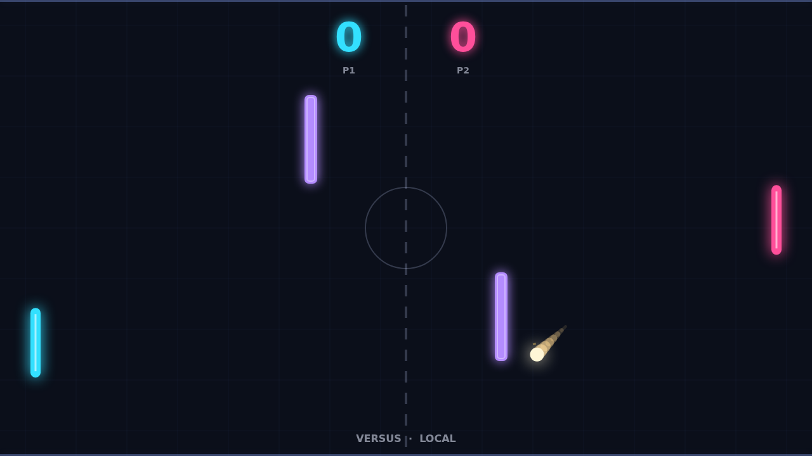
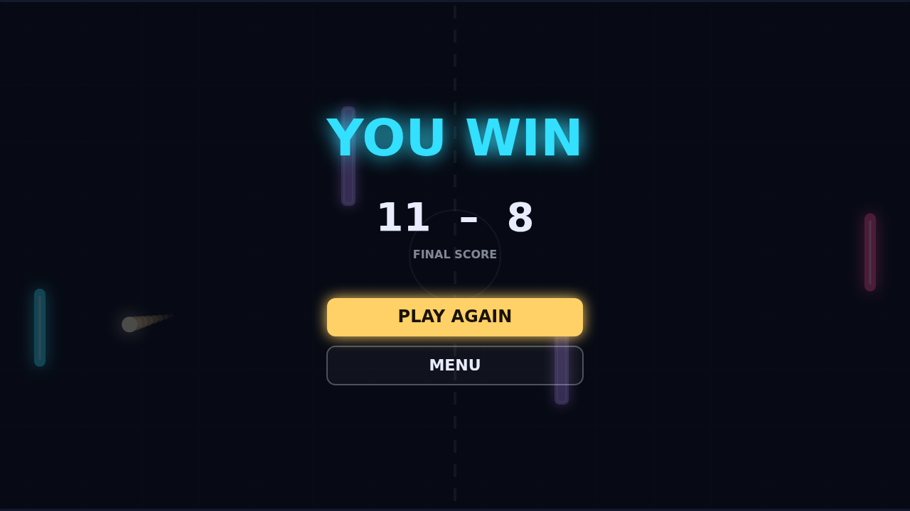

# Carom

Carom is a paddle duel played across a dark, glowing field. You hold the left
paddle; across the net waits a quick-footed CPU in Solo, or a friend on the same
keyboard in Versus. Two violet pillars stand in mid-field, and every rally has to
find its way past them. Get the ball past the far edge behind your opponent and
the point is yours.

Each point opens with the ball resting at center while a ring counts down the
serve, sent toward whoever was just scored on. The first exchanges are gentle,
but every paddle hit speeds the ball up, so a long rally becomes a blur of
light. Where the ball meets your paddle sets its angle: hit it on the center and
it goes straight back, catch it on an end and it leaves at a steep slant. First
to eleven wins, and you have to win by two, so a match point at 10–10 can go on
for a while.

The real weapon is spin. Swing your paddle up or down as you strike and the ball
picks up that motion and bends through the air, curving off its line and
slowly straightening out as the spin fades. A downward swipe can send a shot
over a pillar and drop it into the corner, and a flat return can be turned into
one the CPU misreads.

The pillars turn the field into a bank-shot puzzle. Angle a shot off a pillar's
face and it ricochets toward the far post; send one past a pillar's end and it
skims by. Spin carries through every bounce, so a curving ball that clips a pillar
keeps bending afterward.

